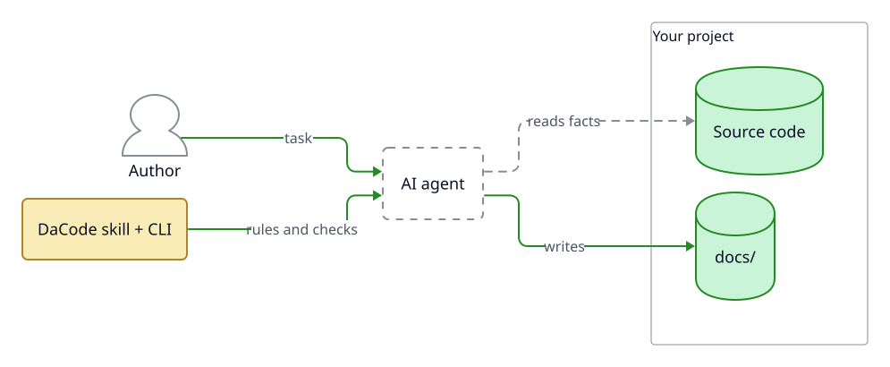

# DaCode

DaCode is a documentation toolset for concise technical writing, editable system diagrams, and chart specifications. Install it once, then use its shared agent skill or command-line tools in any project.

## Install

Clone DaCode once and link its skill and command to your user account:

```sh
mkdir -p ~/.local/share
gh repo clone kobaltoxid/dacode ~/.local/share/dacode
~/.local/share/dacode/scripts/install-user.sh
```

The installer adds D2 v0.9.0 for macOS or Linux and links the CLI and skill. It verifies the archive against D2's published SHA-256 checksum. The CLI requires Python 3.10 or newer.

The installer creates links for Codex and Claude Code skills and for `~/.local/bin/dacode`. Start a new agent session after installation. Add `~/.local/bin` to `PATH` if the `dacode` command is not found. Install only one agent's skill with `install-user.sh codex` or `install-user.sh claude`.

## Use it in a project

Ask the agent to document a feature, explain a system, or create a diagram. The DaCode skill inspects the project, follows its canonical writing rules, and puts new work under the target project's root `docs/` directory.

The CLI can scaffold pages and editable sources directly:

```sh
cd path/to/project
dacode new how-to configure-alerts
dacode new diagram alert-flow
dacode new chart requests-by-region
```

These commands create `docs/configure-alerts.md`, `docs/diagrams/alert-flow.d2`, and `docs/charts/requests-by-region.vl.json`. A `system-design` page also gets its two D2 sources in `docs/diagrams/`. They do not overwrite existing files. Fill the generated sources with verified project details.

Render D2 sources and check the documentation:

```sh
dacode render docs/diagrams
dacode check docs
```

The renderer uses the installed D2 v0.9.0 to create both SVG and PNG outputs beside each D2 source. The checks validate Markdown structure and prose, local links, diagram source/output pairs, and Vega-Lite JSON structure. They do not judge technical correctness or whether an agent followed every instruction.

For an agent that does not load skills, provide a portable prompt:

```sh
dacode prompt "Document the request and response flow" > /tmp/dacode-prompt.md
```

`dacode prompt` combines the task with the canonical ruleset. It writes text only; it does not call a model.

## Structure

The installed skill supplies one workflow to supported agents. The CLI scaffolds and checks files in the target project; D2 renders diagram sources into SVGs and PNG previews.



Figure 1. The skill and CLI produce reviewable files in a project's `docs/` folder. See the [D2 source](diagrams/project-structure.d2), [SVG](diagrams/project-structure.svg), or [PNG preview](diagrams/project-structure.png).

## Scope

DaCode does not run an agent, publish a documentation site, or render Vega-Lite charts. Chart specifications and data stay editable for the host project to render. Local models can use the prompt output, but each client may have its own prompt input method.
