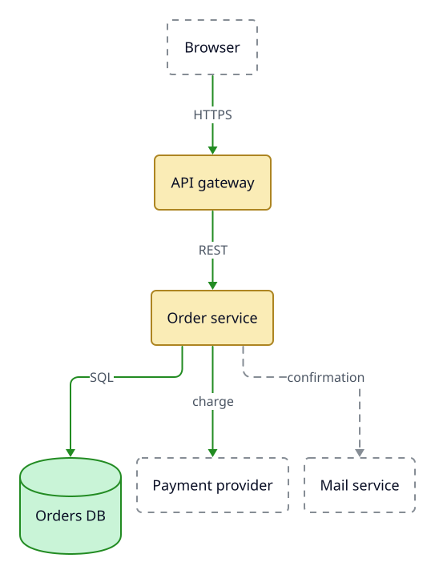
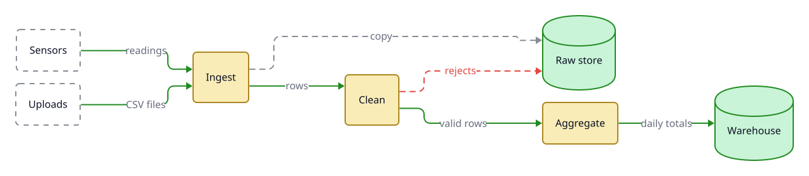
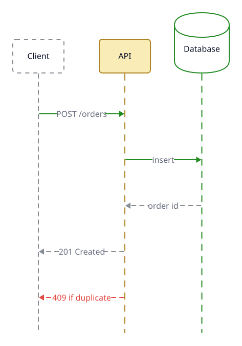
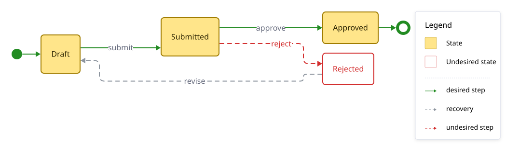

# Example: Diagram style

These fictional diagrams show how DaCode's role classes look in the four most common diagram types. Copy the pattern, not the content.

Each color names a role. Yellow boxes are components the system owns, and green cylinders are stored data. Dashed grey boxes are outside the system. Forest-green arrows show the desired path, dashed grey arrows show replies or side effects, and red marks only what should not happen.

## Architecture

Figure 1. Yellow boxes are owned components; dashed boxes are external services. Key: green, request path; dashed grey, side effect. See the [D2 source](style-architecture.d2).

## Data flow

Figure 2. The main path runs top to bottom; the red branch shows rows the clean step rejects. Dashboards read the warehouse; they are left out to keep the diagram short. Key: green, main path; dashed grey, copy; red, rejected rows. See the [D2 source](style-dataflow.d2).

## Sequence

Figure 3. Key: green, call; dashed grey, reply; red, the duplicate error. See the [D2 source](style-sequence.d2).

## State machine

Figure 4. Rejection is the only undesired transition. Key: green, desired step; dashed grey, recovery; red, undesired step or state. See the [D2 source](style-state.d2).

## What makes these readable

- Each diagram answers one question and keeps its main path in one direction.
- Arrow labels use one to three words. The caption carries the explanation.
- Every color repeats a shape cue, so the diagram still reads in grayscale.
- The caption carries a one-line key when a diagram uses red or three or more arrow roles.
- Each render stays within 1,000 pixels, so text stays near full size in a GitHub README column.
