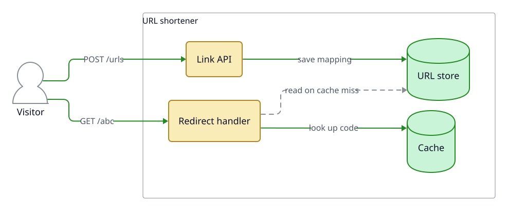

# Example: URL shortener

This fictional design stores a short code and destination URL, then redirects a visitor who opens the code.

The diagram separates request handlers from stored data. Read the link-creation and redirect paths as separate flows through the same system.

Figure 1. The Link API writes mappings; the redirect handler checks the cache and falls back to the URL store. See the [D2 source](system-design.d2).

The Link API saves a mapping before returning the short URL. The redirect handler returns a permanent redirect using the cached destination or a URL-store lookup. Separate handlers, a cache, and a permanent redirect are illustrative assumptions. A real design needs requirements for collisions, abuse, availability, and cache consistency.
